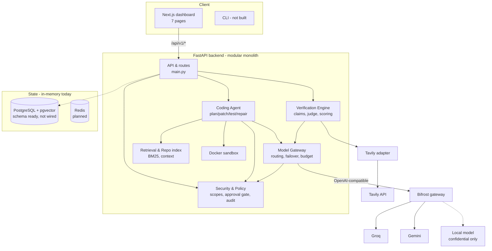

# Component diagram

Confidential repositories: the gateway refuses any remote provider for repo-derived content and falls closed to a
local model, enforced in `security.py` / `gateway.py`, not in prompts.
